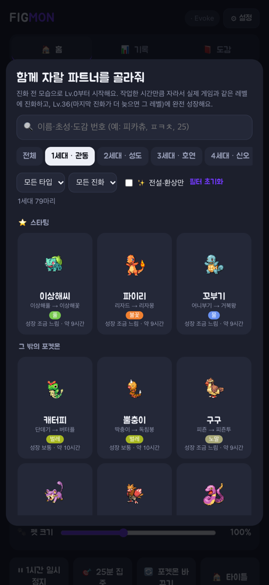
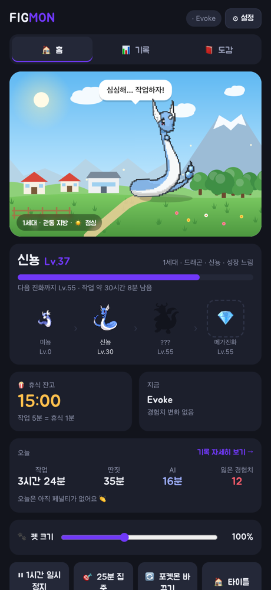
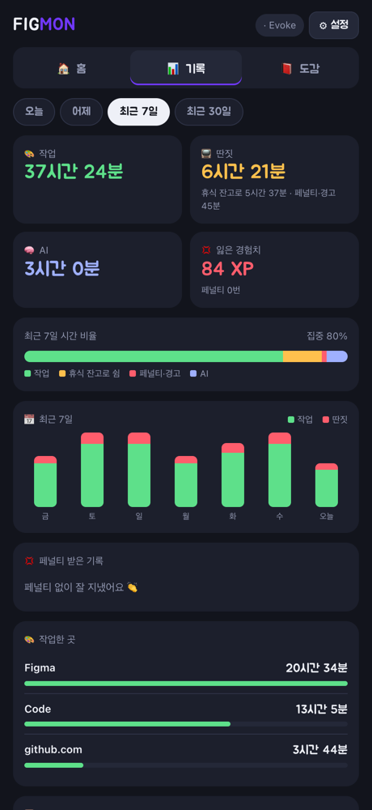
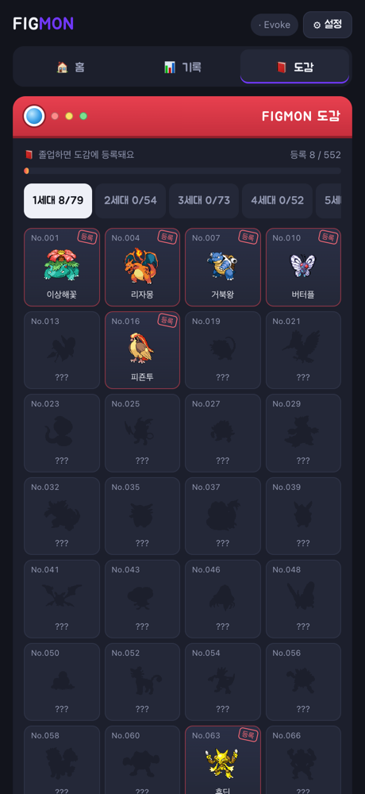

<p align="right"><a href="README.md">한국어</a> · <b>English</b></p>

<p align="center">
  
</p>

<p align="center">
  <b>The more you design in Figma and code in VS Code, the more your Pokémon grows.</b><br>
  Slacking off on YouTube, Instagram or games? Your Pokémon runs over to stop you. 😤
</p>

<p align="center">
  
  
  
  
</p>

> ⚠️ **This is an unofficial, non-commercial fan project.** It makes no money and never will: no sales, ads or donations.
> No Pokémon image files are stored in this repository (except the app screenshots in this README). See [License & Copyright](#license).

> The app itself is in **Korean only**. This page is an English guide to it.

**Contents** · [What is it?](#-what-is-it) · [Screenshots](#-screenshots) · [Install](#-install) · [Troubleshooting](#-troubleshooting) · [How to use](#-how-to-use) · [Growth & evolution](#-growth--evolution) · [Brag card](#-brag-card) · [Files](#-files) · [Recent changes](#-recent-changes) · [License](#license)

---

## ✨ What is it?

| | |
|---|---|
| 🐣 **Grow together** | Pick from **~550 evolution lines across Gen 1–9** (by their first form) and raise one from **Lv.0**. Growth follows the **real games' experience curves by growth group**, and Pokémon **evolve at the same levels as in the games** (e.g. Dratini → Lv.30 Dragonair → Lv.55 Dragonite). |
| ✨ **Evolution scenes** | Light gathers into a white silhouette, the old and new forms flicker faster and faster, then pop! Mega Evolution plays Key Stone → rainbow beams → a shell of light that cracks open. |
| 🧬 **Many evolution paths** | **Branching evolutions** decided by your habits, **8 Eeveelutions** chosen by time of day, and **💎 90+ Mega Evolutions**. |
| 🔒 **Legendary & Mythical challenges** | Graduating regular Pokémon unlocks Legendaries and Mythicals one by one. The final challenge is 👑 **Arceus** (18 type forms), behind the **Trial of the Gods**. |
| 🗺️ **Regions & sacred places** | Each generation has its own region backdrop, **Kanto to Paldea**. Legendaries and Mythicals live in **their own sacred places** (Whirl Islands, Sky Pillar, Distortion World…). The sky shifts through morning, day, evening and night. |
| 🚶 **Desktop pet** | Your Pokémon walks along the bottom of the screen and watches by your cursor while you work. It reacts to clicks, petting and throwing (no XP for that). |
| 🍿 **Break bank & penalties** | Every 5 minutes of work saves 1 minute of break. Slack off with an empty bank and you get a warning, then lose XP. |
| 🧠 **AI moderation mode** | (Optional) Limits ChatGPT, Claude, Gemini and similar tools to a free daily allowance. |
| 🏆 **Brag card** | Reach full growth or Mega Evolve and you get an **Instagram-story-sized card** with your stats and badges. **Final evolution, Mega, Legendary, Mythical and Arceus** each have their own design. |
| 📊 **Records & auto-update** | Work, distraction and AI time per app/site, plus penalty history. New versions download and install themselves. |

---

## 🖼 Screenshots

Taken from the real dashboard (`http://127.0.0.1:7777`) on v1.28.2. Records and Pokédex entries are sample data.

<table>
  <tr>
    <td align="center" valign="top"></td>
    <td align="center" valign="top"></td>
    <td align="center" valign="top"></td>
    <td align="center" valign="top"></td>
  </tr>
  <tr>
    <td align="center">① Pick a Pokémon</td>
    <td align="center">② Home — grow together</td>
    <td align="center">③ Records — work · distraction · AI</td>
    <td align="center">④ Pokédex — register by graduating</td>
  </tr>
</table>

---


## 🚀 Install

Download the file for your computer from [**Releases**](https://github.com/jinjwon/figmon/releases/latest).

| | 🍎 macOS | 🪟 Windows |
|---|---|---|
| Supported | **macOS 13 Ventura or later** (Sonoma · Sequoia · Tahoe), **Apple Silicon and Intel** | Windows 10 / 11 |
| File | `Figmon-macOS.zip` | `Figmon-Windows.zip` |
| Install | Unzip and move `Figmon.app` to **Applications** | Unzip and put `Figmon.exe` on the Desktop or in Documents |
| First run | See [First run (macOS)](#first-run-macos) below | If "Windows protected your PC" appears: **More info → Run anyway** |
| Requires | Python 3 (the app offers to install developer tools if missing) | Nothing (bundled in the exe) |
| Menu | Menu bar icon / right-click the pet | Right-click the pet |

### First run (macOS)
Figmon is a personal project, not from the App Store and not notarized by Apple, so macOS blocks it the first time.
1. Open `Figmon.app`. When the warning appears, click **Done**.
2. Open **System Settings › Privacy & Security** and scroll to the bottom.
3. Next to "Figmon was blocked", click **Open Anyway** and confirm with your password or Touch ID.
4. Click **Open** in the next dialog. After this it opens normally.

> On macOS 14 and earlier, **right-click → Open** also works. From macOS 15 Sequoia on, use **Open Anyway** above.

<details>
<summary><b>Run from source</b></summary>


```bash
git clone https://github.com/jinjwon/figmon.git
cd figmon

# macOS: build and run the app (needs Xcode Command Line Tools; builds universal for macOS 13+)
./build_app.sh && open dist/Figmon.app

# Windows: Python 3.9+ starts the server and pet together (python.org installer recommended, includes tkinter)
python server.py
```

</details>

---

## 🩹 Troubleshooting

<details>
<summary>Show details</summary>


| Message | Cause | Fix |
|---|---|---|
| "can't be used with this version of macOS" / prohibited sign on the icon | Build problem in **v1.23.0 and earlier** (built for macOS 26 only) | **Download the latest version again**. An app that won't open can't auto-update either |
| "unidentified developer" / "cannot verify it is free of malware" | macOS security (Gatekeeper) | **Open Anyway** in [First run (macOS)](#first-run-macos) |
| "is damaged and can't be opened" | Quarantine flag on downloaded files (it isn't really damaged) | Move the app to Applications, then run the command below |
| App opens but no pet / developer tools installer appears | Python (Xcode Command Line Tools) missing | Click **Install**, then reopen Figmon |
| 🪟 The exe disappears or is blocked | Antivirus false positive (e.g. Windows Defender) | Allow it in **Windows Security › Virus & threat protection › Protection history** |
| 🍎 Auto-update doesn't work | Running from Downloads or similar | When Figmon asks **"Move to Applications?"**, choose **Move and relaunch** |
| 🪟 Auto-update doesn't work | Folder isn't writable (e.g. Program Files) | Move `Figmon.exe` to the Desktop or Documents |

For "is damaged" (removes only Figmon's quarantine flag):

```bash
xattr -dr com.apple.quarantine /Applications/Figmon.app
```

</details>

---

## 📖 How to use

### 1. Pick a Pokémon
The **FIGMON title screen** opens on launch. Press **▶ Start**, pick a partner and confirm. You start together at Lv.0.
- **🔍 Search** by name, Korean initial consonants, or **Pokédex number** (25). Searching an evolved form shows its first form.
- **Filters**: generation, type, evolution stages (none · 2 · 3), ✨ Legendary/Mythical
- Before choosing, you see the **evolution path** (e.g. "Lv.0 Pikachu → Lv.25 Raichu (originally Thunder Stone)") and **time to full growth**.

### 2. Work as usual
Keep a work app like Figma or VS Code in front and work.
- 1 minute of work = **+3 XP** (Legendary ×0.9 · Mythical ×0.85 · Arceus ×0.7)
- 5 minutes of work = **+1 minute of break bank** (max 60 minutes)
- 2 minutes with no keyboard/mouse input counts as away and isn't counted
- Figma, Sketch, Framer, VS Code, Cursor, Xcode, JetBrains IDEs, terminals, github.com and more are work apps by default. Settings has **🎨 Designer / 💻 Developer / Both** presets.

### 3. Taking a break
YouTube, Instagram, TikTok and games use your **break bank**. While it lasts, you're fine. When it hits 0:
1. Your Pokémon runs to your cursor and trembles, and a notification and popup appear
2. Click **Back to work** in the popup to reopen your last work app
3. If you don't return within 20 seconds, you lose **3 XP per minute** (your level can drop, but never below the current evolution stage)

In meetings or away, **⏸ Pause tracking** (30 min / 1 hour / 2 hours / rest of today) stops XP and penalties.

### 4. Desktop pet

| Action | Result |
|---|---|
| Click the pet | Hops with a heart and a line (click repeatedly and it gets ticklish) |
| Double-click | Opens the dashboard |
| Hover | Notices you with a "!" |
| Rub the cursor side to side | Petting (wiggles with hearts) |
| Drag | Pick it up and move it (drops and lands when released) |
| Throw hard | Spins away, bounces off the edge, and lands dizzy 😵 |
| Right-click / menu bar icon | Dashboard · call it over · **pet size (60–160%)** · hide · pause tracking · launch at login · check for updates · quit |

<details>
<summary><b>🎯 Focus mode · hide speech bubbles</b></summary>

- **🎯 25-min focus** on Home: settings and pause lock for 25 minutes; the pet stays nearby without bubbles and only shifts a little (never crosses the screen). Press again to end early.
- Turn off **Show pet speech bubbles** in settings to hide everyday bubbles. Warnings and penalty notices still appear. Same on macOS and Windows.
- Turn on **Minimal pet movement** to keep the pet near one spot. Drag it to a corner so it doesn't cover what you type.

</details>

<details>
<summary><b>🕊 Floating Pokémon</b></summary>

Flying types and Pokémon with Levitate (Charizard, Dragonite, Gastly…) hover instead of standing. Eggs don't float.

</details>

<details>
<summary><b>🧠 AI usage reports</b></summary>

The pet occasionally reports Claude Code and Codex usage in a bubble, and on the **Today** card on Home.
- **Tokens used today**: read only from the logs both tools keep on this computer (`~/.claude/projects`, `~/.codex/sessions`). Input + output, excluding cache reuse. No network or login data is used.
- **Remaining limits** (5-hour · weekly): Codex logs include them. Claude Code only passes limits to the status line, so add this line to `~/.claude/settings.json` (if you already use a status line, save its input to `~/.figmon/claude_status.json` in your script):
  ```json
  "statusLine": { "type": "command", "command": "cat > ~/.figmon/claude_status.json" }
  ```
- The pet tells you once when a limit drops below 20%.

</details>

<details>
<summary><b>⌨️ Moves with your typing</b></summary>

While you type, the pet reacts with **gestures** instead of words.

| Typing | Pet |
|---|---|
| Each keystroke | Taps its front paws as if typing, with a little keycap under it |
| Enter | A short signature move for that Pokémon (Fire pops, Electric zaps, Ghost fades…) |
| Fast bursts | Glows in its type color with sparks on both sides |
| Very fast | Stamps its feet in place |
| 30+ seconds in the zone | An aura ring spreads underfoot |
| Every 300 keys | Jumps with a sparkle |
| Brief typing, then stop | Looks up: "Hm?" |
| Long typing, then stop | A big stretch |
| While typing | Stops walking and stays by you |

> 🔒 **Figmon never knows which keys you press.** macOS only gives the system's "key press count"; on Windows it only checks "input happened while the mouse stayed still". The one exception is **whether Enter was pressed**. Nothing is saved or sent. No extra permissions needed.

> Petting, throwing, clicking and typing reactions are **reactions only**. XP comes only from work time, so no cheating.

- **macOS**: a menu bar app showing e.g. `🎨 Lv.12`. It appears in the Dock only while the dashboard window is open.
- **Windows**: the pet walks along the taskbar. The dashboard opens as an Edge app window, and clicking the pet doesn't steal focus from your work window.
- **Appears when you start working**: if enabled on first launch, Figmon starts quietly with your computer. After a break of 10+ minutes, opening a work app makes the pet walk in from the screen edge to say hi.

</details>

### 5. Switch or graduate
- **🔄 Switch Pokémon** anytime, but the new one starts **from Lv.0**.
- **🎓 Graduate** a fully grown Pokémon to **register it in the 📕 Pokédex**: its silhouette slot fills with color and gets a "registered" stamp. The Pokédex is a numbered grid with per-generation progress (e.g. Gen 1 8/79). Graduating also counts toward Legendary/Mythical unlocks.

### 6. Records (📊 tab)
- Period: today / yesterday / last 7 days / last 30 days (kept for 60 days)
- Work, distraction and AI time, XP lost, focus ratio, daily bars
- **💢 Penalty history**: when, where (e.g. youtube.com), how long, and how much XP was lost
- Records are stored only on your computer (`~/.figmon/state.json`) and never sent anywhere.

### 7. Settings (⚙︎)
- Split into tabs: **🎨 Work / 📺 Distraction / 🐾 Pet / 🧠 AI / ⚙︎ Other** (rules · updates) · move with **← →**
- **⚡ Classify recent apps/sites**: one click on **[Work] [Distraction] [AI] [Clear]** next to a recently used app/site
- **Edit lists**: remove a tag with **×**, type in the field and press **Enter** to add
- Break ratio, penalty strength, grace period and away detection can only change **within set ranges**. XP per work minute can't be changed (anti-cheat).
- **🧠 AI moderation mode**: AI time beyond the free daily allowance (30 minutes by default) counts as distraction
- **Auto-update**: checks 10 seconds after launch and every hour, then swaps itself in. You can turn it off or check now in settings.

<details>
<summary><b>🔎 How distractions are detected</b></summary>

- **Browsers**: by the open tab's URL (on Windows by window title, e.g. "… - YouTube - Chrome").
- **Installed web apps**: web apps installed from Chrome, Brave or Edge are judged by their site URL.
- **Apps**: Instagram, YouTube, Netflix, TVING, wavve and more are included by default.
- **🎮 Automatic game detection**: apps categorized as games and Steam/Epic/Riot games count as distraction even if not listed (can be turned off).
- (macOS) If asked *"wants to control Chrome (or Safari)"*, click **Allow**. It's only used to tell whether the current tab is YouTube or GitHub.

</details>

<details>
<summary><b>♿ Accessibility</b></summary>

- **VoiceOver**: the pet and menu bar icon read like "Mudkip level 12, working".
- **Keyboard**: Tab through every dashboard button and dialog, Esc to close, Enter to start.
- **Reduce motion**: with macOS Accessibility › *Reduce motion* or Windows Accessibility › *Animation effects* off, the pet stops roaming and shakes, particles and **evolution scenes** are turned off (evolution happens instantly).
- **Sharing**: the brag card uses the standard macOS share menu (AirDrop, Messages…) and save dialog.

</details>

---

## 🐣 Growth & evolution

1 minute of work = +3 XP. Growth follows the real games' XP curves and evolution levels; most Pokémon reach full growth after **8–13 hours** of work. Expand the sections below for the tables.

<details>
<summary><b>Growth speed: different XP curves per Pokémon</b></summary>

Figmon uses the real games' **experience curves per growth group** (cubic formulas by level). **Low levels go fast; each level takes longer as you climb.**

| Growth group | To full growth (Lv.36) | Examples |
|---|---|---|
| Fast | ~8 hours | Clefairy, Jigglypuff |
| Medium Slow | ~9 hours (very fast at first) | Most starters |
| Medium Fast | ~10 hours | Rattata, Eevee |
| Erratic | ~10 hours (very slow after Lv.36) | Shroomish, Gulpin, Wailmer |
| Slow | ~12 hours | Dratini, Growlithe, Shellder |
| Fluctuating | ~13 hours (very fast after Lv.36) | Nincada, Swablu |
| ✨ Legendary · 🌟 Mythical | ~10–15 hours | Mewtwo, Lugia, Mew |
| 👑 Arceus | ~18 hours | Arceus |

</details>

<details>
<summary><b>Evolution levels: straight from the games</b></summary>

Pokémon that evolve by non-level conditions (stones, trade, friendship) use a level at a similar point.

| Condition in the games | In Figmon | Examples |
|---|---|---|
| Level | Same level | Charmander → Lv.16 Charmeleon → Lv.36 Charizard, Dratini → Lv.30 Dragonair → Lv.55 Dragonite |
| Friendship | First evolution Lv.20; second = previous +10 (min Lv.30) | Pichu → Lv.20 Pikachu, Golbat (Lv.22) → Lv.32 Crobat |
| Evolution stone or item | First Lv.25; second = previous +12 (min Lv.30) | Pikachu → Lv.25 Raichu, Gloom (Lv.21) → Lv.33 Vileplume |
| Trade | First Lv.30; second = previous +14 (min Lv.30) | Onix → Lv.30 Steelix, Haunter (Lv.25) → Lv.39 Gengar |
| Other special conditions | First Lv.25; second = previous +12 (min Lv.30) | Gligar → Lv.25 Gliscor, Piloswine (Lv.33) → Lv.45 Mamoswine |

**Full growth** is Lv.36. If the last evolution comes later, full growth is **the last evolution level**.

| Pokémon | Full growth | Work time |
|---|---|---|
| Most Pokémon | Lv.36 | ~8–13 hours |
| Gengar · Magnezone · Porygon-Z | Lv.39–44 | ~11–18 hours |
| Metagross · Kingdra | Lv.45–46 | ~21–24 hours |
| Garchomp · Salamence · Goodra | Lv.48–50 | ~30–33 hours |
| Dragonite · Tyranitar · Rhyperior | Lv.55–56 | ~45–47 hours |
| Dragapult · Hydreigon | Lv.60–64 | ~58–70 hours |

Pokémon that don't evolve (Snorlax, Mew…) keep their form but grow bigger as they level up.

</details>

<details>
<summary><b>Special evolutions</b></summary>


| Kind | Who | Decided by |
|---|---|---|
| 🔮 Branching | Ralts, Tyrogue, Cosmog and 10 more lines | Your habits while raising it (automatic) |
| 🌗 Eevee | Eevee (8 forms) | Time of day you worked → you choose |
| 💎 Mega Evolution | Charizard, Mewtwo, Lucario and ~90 more | Reaching Lv.45 (X/Y by habits) |
| 👑 Arceus types | Arceus (18 forms) | Time worked together → you choose |

**🔮 Branching evolution**: at the evolution level it evolves toward **the highest habit score**. "🔮 Evolution forecast" on the dashboard shows which way it leans.

| Condition | Score | Examples |
|---|---|---|
| ☀️ Day / 🌙 Night | Whether you worked more by day (6–18h) or night | Solgaleo/Lunala, Sneasler/Weavile, Beautifly/Dustox |
| 🔥 Hard work | Average daily work time (4 hours = max) | Gallade, Hitmonlee, Huntail, Flapple |
| 🎯 Less distraction | Lower distraction ratio | Gardevoir, Hitmonchan, Gorebyss, Appletun |
| 🍿 Balance | Using the break bank well, few penalties | Hitmontop, Dipplin |

**🌗 Eevee**: work time with Eevee adds up per time of day. At **Lv.20** you choose among the evolutions for **time slots above 25%**.

| Time slot | Candidates |
|---|---|
| 🌅 Morning (6–11h) | Leafeon · Sylveon |
| ☀️ Day (11–17h) | Espeon · Jolteon |
| 🌇 Evening (17–21h) | Flareon · Vaporeon |
| 🌙 Night (21–6h) | Umbreon · Glaceon |

**💎 Mega Evolution**: Pokémon with a Mega form Mega Evolve at **Lv.45** in their final form (or at full growth if that comes later).
- With **X/Y** forms (Charizard, Mewtwo, Raichu), habits decide: long work (🔥) gives **X**, less distraction (🎯) gives **Y**
- After Mega Evolving you can switch **original ↔ Mega**. If penalties drop you below Lv.45, it reverts.

</details>

<details>
<summary><b>✨ Evolution scenes</b></summary>

- **Regular**: light gathers into a white silhouette, old ↔ new forms flicker faster, then pop!
- **💎 Mega**: the Key Stone glows, rainbow beams spread, and a rainbow shell wraps the Pokémon and cracks open.
- Plays on the dashboard and desktop pet (macOS · Windows). With reduced motion it changes instantly.

</details>

<details>
<summary><b>🔒 Legendary & Mythical Pokémon</b></summary>

Locked at first. **Raise regular Pokémon to full growth and graduate them** to unlock them one by one.

| Tier | Who | Unlock |
|---|---|---|
| ✨ Legendary | Articuno, Lugia, Rayquaza… | Graduate 1–3 from the same generation (more for stronger ones) + 1 of the same type |
| 🌟 Mythical | Mew, Celebi, Darkrai… | One more than the Legendary requirement |
| 👑 Arceus | Arceus only | All 4 parts of the **Trial of the Gods** |

| Example | Unlock |
|---|---|
| Articuno | Graduate 1 Gen 1 (incl. 1 Ice) |
| Mewtwo | Graduate 3 Gen 1 (incl. 1 Psychic) |
| Lugia | Graduate 3 Gen 2 (incl. 1 Psychic) |
| Rayquaza | Graduate 3 Gen 3 (incl. 1 Dragon) |
| Dialga | Graduate 3 Gen 4 (incl. 1 Steel) |

Locked cards show progress like "🔒 Gen 1 2/3 · Psychic 1/1". Once unlocked, each lives in its own **sacred place backdrop**.

**👑 Arceus: Trial of the Gods** — all four are required.

| Trial | Needed |
|---|---|
| Graduated Pokémon | 12 |
| Different types graduated | 10 |
| Gen 4 Pokémon graduated | 4 |
| A creation deity (Dialga · Palkia · Giratina) graduated | 1 |

After that, every **3 hours** of work together unlocks a new type (Plate), opening **18 forms** one by one (51 hours for all).

</details>

---

## 🏆 Brag card

<details>
<summary>Show details</summary>


At full growth or Mega Evolution, an **Instagram-story-sized (1080×1920)** card appears. Reopen it from "🏆 Brag card" on Home to save it or copy its text.

**What's on it**
- The place you raised it (region · sacred place) and your Pokémon
- **6 stats**: work time · level · days together · focus rate · daily average · graduation number
- **Badges** (up to 4): 💎 Mega Evolution, ✦ Legendary / ✧ Mythical unlocked, 🎯 Focus master (90%+), 😇 Zero penalties, 💪 4+ hours a day, ☀️ Day / 🌙 Night worker, 🍿 Smart breaks
- **Evolution path**: each form and its level (Mega form last if Mega Evolved)

**Design by tier**

| Tier | Design |
|---|---|
| ★ Final evolution · full growth | Type-colored border and glow |
| 💎 Mega Evolution | Rainbow border · prism rays · rainbow ring |
| ✦ Legendary | Double gold border with corner ornaments and a golden halo. The accent is **that Legendary's sacred-place color**, so each one differs (the place name appears too) |
| ✧ Mythical | Aurora border (pink · purple · sky), floating light bubbles |
| 👑 Arceus | Golden halo + **18-type ring** (unlocked types glow) |

</details>

---

## 🗂 Files

<details>
<summary>Show details</summary>


| File | Platform | Role |
|---|---|---|
| `server.py` | Both | Core. Version (`VERSION`), Gen 1 data, growth curves and evolution levels, app/tab detection (macOS: lsappinfo · AppleScript / Windows: Win32 API · window titles), XP · break bank · penalties, notifications, HTTP API, Windows auto-update. Python standard library only |
| `pokedex.json` | Both | Gen 2–9 evolution lines and Korean names, growth groups and stats, **real evolution conditions**, Mega list (generated from PokeAPI public data) |
| `tools/build_pokedex.py` | Both | Rebuilds `pokedex.json` (`--evo` for evolution conditions only) |
| `index.html` | Both | Dashboard: title, Pokémon picker, region/sacred-place backdrops, evolution scenes, records, Pokédex, settings, brag card |
| `pet.html` | macOS | Desktop pet view: sprite, speech bubbles, reactions, evolution scenes |
| `Figmon.swift` | macOS | App: runs the server, transparent pet window, menu bar, auto-update, move to Applications, save · share |
| `build_app.sh` | macOS | Builds `dist/Figmon.app` (universal for macOS 13+, icon, Info.plist, signing, zip) |
| `start.command` | macOS | Double-click to build if needed and launch |
| `pet_win.py` | Windows | Pet window (tkinter): transparent, always on top, reactions, evolution scenes, right-click menu, launch at login |
| `.github/workflows/windows.yml` | Windows | GitHub Actions checks and builds `Figmon.exe` (PyInstaller) and uploads it to releases |
| `tools/win_smoketest.py` | Windows | Smoke test: detection, classification, notifications, saving, pet view, auto-update |
| `tests/` | Both | Regression tests for pet movement and new evolution stages (`python3 -m unittest discover -s tests`) |
| `tools/make_icon.swift` · `assets/` · `docs/banner.svg` | Both | App icon and README banner (original illustrations) |
| `docs/screenshots/` | Both | README screenshots |
| `AGENTS.md` | Both | Structure, build and release guide for AI coding tools (Codex, Claude Code…) |
| `NOTICE.md` · `LICENSE` | Both | Non-commercial fan project notice · MIT license for the code |

For testing, you can fast-forward time: `FIGMON_SPEED=60 python3 server.py` (1 real second = 1 minute)

</details>

---

## 🆕 Recent changes

| Version | Changes |
|---|---|
| **v1.28.2** | 🗂 **Settings split into tabs** (Work / Distraction / Pet / AI / Other), no more long scrolling · ← → keys move between tabs |
| v1.28.1 | 🔧 Fixed long toasts (e.g. update notices) staying stuck at the top of the dashboard |
| **v1.28.0** | 🧠 **AI usage reports** (today's Claude Code · Codex tokens and remaining limits, in pet speech bubbles and on Home) · 🕊 **Flying/levitating Pokémon float** · 🧘 **Minimal pet movement** setting · 🔧 Fixed a thrown pet spinning forever, and the pet freezing when the server stopped (macOS, now restarts automatically) |
| v1.27.2 | 🔧 Fixed a speech bubble appearing and never closing when throwing the pet with bubbles off or in focus mode (macOS · Windows) |
| v1.27.1 | ⌨️ Pressing Enter now plays **a signature move per Pokémon** (by type/kind) instead of ↵ |

<details>
<summary>Older versions</summary>

| Version | Changes |
|---|---|
| v1.27.0 | 🎯 **Focus mode** (locks settings and pause for 25 minutes; the pet stays quietly nearby with no bubbles) · 💬 **Hide pet speech bubbles** setting · ⌨️ More typing reactions. macOS · Windows |
| v1.26 | ⌨️ The pet taps along on a keyboard as you type |
| v1.25.1 | 🍎 **Fixed no distractions being detected on macOS 27.** macOS changed the output format for the frontmost app |
| v1.25.0 | 🏆 Redesigned brag card: 6 stats, badges, tier designs. Added later-gen evolutions to Gen 1 lines → **Mega Steelix and Mega Scizor** are obtainable |
| v1.24.0 | ✨ New evolution and Mega Evolution scenes. 🍎 **macOS 13+ and Intel Mac support** (v1.23.0 and earlier were built for macOS 26 only by mistake) |
| v1.23.0 | 🧬 **Real game evolution levels** per Pokémon (stone/trade/friendship evolutions use a level at a similar point) |
| v1.22.0 | 🐣 Growth about 3× faster + **real experience curves per growth group**. Mega Evolution Lv.60 → **Lv.45** |
| v1.20.1 | 🪟 Fixed the Windows pet freezing when made smaller |

</details>

Your Pokémon keeps **its level and form** across updates. Full history is in [Releases](https://github.com/jinjwon/figmon/releases).

---

<a id="license"></a>

## ⚖️ License & Copyright

- This is an **unofficial, non-commercial fan project**. It is not affiliated with, endorsed or sponsored by Nintendo, The Pokémon Company, Creatures Inc. or GAME FREAK inc.
- **It makes no money.** No sales, paid features, ads or donation links. If you fork or use it, **please don't use Pokémon-related elements commercially.**
- Pokémon and Pokémon names, characters and images are © Nintendo / Creatures Inc. / GAME FREAK inc.
- **No Pokémon image files are included** in this repository (the app screenshots in this README are the only exception). At runtime, sprites are loaded from [PokeAPI/sprites](https://github.com/PokeAPI/sprites) and shown only on your screen.
- Pokémon names and evolution data (`pokedex.json`) come from [PokeAPI](https://github.com/PokeAPI/pokeapi) public data.
- If a rights holder asks, it will be changed or taken down right away. Please open an Issue.
- The **code**, excluding Pokémon-related elements, is under the [MIT License](LICENSE). See [NOTICE](NOTICE.md).
