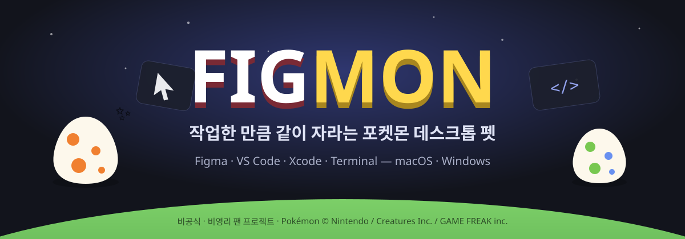

<p align="center">
  
</p>

<p align="center">
  <b>Figma로 디자인하고, VS Code로 코딩할수록 내 포켓몬이 자라요.</b><br>
  유튜브·인스타·게임으로 딴짓하면? 포켓몬이 달려와서 말려요. 😤
</p>

<p align="center">
  
  
  
  
</p>

> ⚠️ **비공식 · 비영리 팬 프로젝트예요.** 이 프로젝트로 수익을 얻지 않고, 앞으로도 얻지 않아요. 판매·광고·후원 같은 수익 활동이 전혀 없어요.
> 포켓몬 이미지는 저장소에 들어 있지 않아요. 자세한 내용은 [라이선스 & 저작권](#-라이선스--저작권)을 봐주세요.

---

## ✨ 어떤 앱인가요?

| | |
|---|---|
| 🐣 **같이 성장** | **1~9세대 포켓몬 860여 마리**(각 세대에서 처음 나온 진화 전 모습 기준) 중에서 골라 **진화 전 모습, Lv.0**부터 시작해요. 3단 진화는 Lv.16·36, 2단 진화는 Lv.20에 진화하고, 모두 **Lv.36에 완전 성장**해요. |
| 🗺️ **지방 배경 · 시간대** | 세대마다 **관동·성도·호연·신오·하나·칼로스·알로라·가라르·팔데아** 배경이 달라요. 시간에 따라 **아침·점심·저녁·새벽** 하늘도 바뀌어요. |
| 🚶 **데스크톱 펫** | 포켓몬이 화면 아래를 천천히 걸어 다니고, 일할 때는 커서 옆에 와서 지켜봐요. 레벨이 오를수록 몸집도 커져요. |
| 💕 **교감** | 클릭하면 깡총 뛰며 하트, 커서로 비비면 쓰담쓰담, 세게 던지면 날아갔다가 깜짝 놀라요. 반응만 하고 경험치는 안 줘요. |
| 🎨💻 **디자이너·개발자** | Figma, Sketch, Framer, VS Code, Cursor, Xcode, JetBrains, 터미널, github.com 등에서 일한 시간이 경험치가 돼요. |
| 🍿 **휴식 잔고** | 작업 5분마다 휴식 1분이 쌓여요. 쌓아 둔 만큼은 유튜브를 봐도 괜찮아요. |
| 💢 **페널티** | 잔고 없이 딴짓하면 경고 후 경험치가 깎여요. 레벨은 떨어져도 퇴화는 안 해요. |
| 🧠 **AI 절제 모드** | (선택) ChatGPT·Claude·Gemini 등을 하루 무료 시간만큼만 쓰게 해요. |
| 🚶‍♂️ **작업 앱을 켜면 등장** | 10분 넘게 쉬다가 Figma·VS Code 같은 작업 앱을 켜면 포켓몬이 화면 가장자리에서 걸어 나와 인사해요. |
| 🔄 **자동 업데이트** | 새 버전이 나오면 알아서 받아 바꿔 끼우고 다시 켜져요. 키우던 포켓몬은 그대로예요. |
| 📊 **기록** | 앱·사이트별로 작업·딴짓·AI 시간이 남아요. 어디서 페널티를 받았는지, 경험치를 얼마나 잃었는지 날짜별로 볼 수 있어요. |
| ⏸ **일시정지** | 회의·외출 중에는 30분~하루 동안 경험치와 페널티를 멈춰요. |
| 🏆 **자랑 카드** | Lv.36에 완전 성장하면 공유용 이미지 카드가 만들어져요. |

---

## 🚀 설치

**macOS와 Windows 둘 다 돼요.** [**Releases**](https://github.com/jinjwon/figmon/releases/latest)에서 내 컴퓨터에 맞는 파일을 받으면 돼요.

| | 🍎 macOS 13+ | 🪟 Windows 10 / 11 |
|---|---|---|
| 받을 파일 | `Figmon-macOS.zip` | `Figmon-Windows.zip` |
| 설치 | 압축을 풀고 `Figmon.app`을 **응용 프로그램** 폴더로 옮기기 | 압축을 풀고 `Figmon.exe`를 원하는 폴더에 두기 |
| 첫 실행 | **우클릭 → 열기**. 막히면 시스템 설정 › 개인정보 보호 및 보안 › **그래도 열기** | "PC 보호" 창이 뜨면 **추가 정보 → 실행** |
| 필요한 것 | Python 3 (없으면 앱이 `xcode-select --install`을 안내해요) | 없음 (exe 안에 다 들어 있어요) |
| 메뉴 | 메뉴 막대 아이콘 / 펫 우클릭 | 펫 우클릭 |
| 자동 실행 | 메뉴 › 로그인할 때 자동 실행 | 펫 우클릭 › Windows 시작 시 자동 실행 |

> 앱스토어나 MS 스토어 앱이 아니고, 코드 서명이 없는 개인 프로젝트라서 처음 한 번은 경고가 떠요.

### 소스로 직접 실행

```bash
git clone https://github.com/jinjwon/figmon.git
cd figmon

# macOS: 앱으로 빌드해서 실행 (Xcode Command Line Tools 필요)
./build_app.sh && open dist/Figmon.app

# Windows: Python 3.9+만 있으면 서버 + 펫이 함께 떠요 (python.org 설치판 권장, tkinter 포함)
python server.py
```

---

## 📖 사용법

### 1. 타이틀 화면 → 포켓몬 고르기
실행하면 **FIGMON 타이틀 화면**이 떠요.
**▶ 시작하기**를 누르면 포켓몬 선택 창이 열려요. 마음에 드는 친구를 골라 **이 친구로 할래!**를 누르면 Lv.0부터 함께 시작해요.
- **🔍 검색**: 이름(피카츄), **초성**(ㅍㅋㅊ), **도감 번호**(25)로 찾을 수 있어요. 진화형 이름으로 찾아도 진화 전 포켓몬이 나와요.
- **필터**: 세대(전체·1~9세대), 타입, 진화 단계(진화 없음·2단·3단), ✨ 전설·환상
- **포켓몬**: 1세대 151마리 전부와, 2~9세대에서 처음 등장한 진화 전 포켓몬이 모두 있어요. 진화가 갈라지는 포켓몬(예: 랄토스 → 가디안 / 엘레이드)은 진화 방향별로 골라요.

#### 🐢 포켓몬마다 다른 성장 속도
실제 게임의 **성장 그룹**을 그대로 써요. 카드와 선택 창에 "성장 느림 · 약 50시간"처럼 보여요.

| 성장 그룹 | 완전 성장(Lv.36)까지 | 예 |
|---|---|---|
| 빠름 | 약 30시간 | 삐삐, 푸린 |
| 보통 | 약 35시간 | 꼬렛, 이브이 |
| 변덕 (빠른 편) | 약 38시간 | 토중몬, 파비코 |
| 조금 느림 | 약 40시간 | 대부분의 스타팅 |
| 느림 | 약 50시간 | 미뇽, 가디, 셀러 |
| 변덕 (느린 편) | 약 55시간 | 버섯꼬, 꼴깍몬, 고래왕자 |

#### ✨ 전설 · 🌟 환상 포켓몬 (도전 요소)
처음엔 🔒 잠겨 있어요. 포켓몬을 Lv.36까지 키워 **졸업**시키면 열려요. **여는 조건은 포켓몬마다 달라요.** 능력치가 셀수록 더 많이 졸업시켜야 해요.

| 능력치 합계 | ✨ 전설 | 🌟 환상 | 예 |
|---|---|---|---|
| 600 미만 | 1마리 졸업 | 2마리 | 프리져, 셀레비 |
| 600~679 | 2마리 | 3마리 | 코라이돈, 뮤 |
| 680 이상 | 3마리 | 4마리 | 뮤츠, 아르세우스 |

열어도 성장 그룹보다 더 느리게 자라요 (전설 ×0.7, 환상 ×0.6 → 약 65~85시간). 페널티는 똑같이 깎여서, 키우는 중에 딴짓하면 더 아파요.

#### 🛡️ 꼼수 방지
작업 1분당 경험치는 **설정으로 바꿀 수 없어요.** 휴식 비율, 페널티, 자리비움 판정 같은 값도 정해진 범위 안에서만 바꿀 수 있어요 (예: 자리비움은 최대 10분).
- **이브이**: 진화형 8가지(샤미드·쥬피썬더·부스터·에브이·블래키·리피아·글레이시아·님피아)가 모두 있어요. 아래 "이브이 진화"를 봐 주세요.

### 2. 평소처럼 일하기
Figma나 VS Code 같은 작업 앱을 앞에 띄워 두고 일하면 돼요.
- 작업 1분 = **경험치 +1** (50 경험치마다 레벨 업)
- 작업 5분 = **휴식 잔고 +1분**
- 2분 동안 키보드·마우스 입력이 없으면 자리비움으로 보고 시간에 넣지 않아요

| 레벨 | 모습 | 필요한 작업 시간 (대략) |
|---|---|---|
| Lv.0 | 기본형 (예: 파이리, 피카츄, 잠만보) | 시작 |
| Lv.16 | 3단 진화의 1차 진화 (예: 리자드) | 약 13시간 |
| Lv.20 | 2단 진화 (예: 피카츄 → 라이츄) | 약 17시간 |
| Lv.36 | 3단 진화의 최종 진화 (예: 리자몽) + **모두 완전 성장** → 자랑 카드·졸업 | 약 30시간 |

진화하지 않는 포켓몬(잠만보, 뮤 등)은 모습은 그대로지만 레벨이 오를수록 몸집이 커져요.

#### 🌗 이브이 진화: 일한 시간대에 따라
이브이로 일한 시간이 **시간대별 게이지**로 쌓여요. **Lv.20**이 되면 진화 선택 창이 뜨고, **25% 넘게 일한 시간대**의 진화형 중에서 직접 골라요. 가장 많이 일한 시간대는 항상 열려 있어요.

| 시간대 | 진화 후보 |
|---|---|
| 🌅 아침 (6~11시) | 리피아 · 님피아 |
| ☀️ 점심 (11~17시) | 에브이 · 쥬피썬더 |
| 🌇 저녁 (17~21시) | 부스터 · 샤미드 |
| 🌙 새벽 (21~6시) | 블래키 · 글레이시아 |

대시보드의 "이브이의 마음"에서 지금 어느 쪽으로 기울고 있는지 볼 수 있어요. 진화형은 한 번 고르면 바꿀 수 없어요.

### 3. 쉬고 싶을 때
유튜브·인스타·틱톡·게임은 **휴식 잔고**를 써요. 잔고가 남아 있으면 페널티가 없어요.
잔고가 0이 되면:
1. 포켓몬이 커서로 달려와 부들부들 떨고, macOS 알림과 팝업이 떠요
2. 팝업에서 **작업으로 돌아갈게**를 누르면 마지막에 쓰던 작업 앱이 바로 열려요
3. 20초 안에 돌아가지 않으면 **분당 경험치 -3**

### 4. 데스크톱 펫 & 메뉴 막대
**macOS**에서 Figmon은 **메뉴 막대 앱**이에요. Dock 대신 화면 위 메뉴 막대에 `🎨 Lv.12`처럼 떠 있어요. 대시보드 창이 열려 있는 동안에만 Dock에 보여요.

| 동작 | 결과 |
|---|---|
| 펫 클릭 | 깡총 뛰며 하트 + 한마디 (연달아 누르면 간지러워해요) |
| 펫 두 번 클릭 | 대시보드 열기 |
| 커서 올리기 | "!" 하고 알아챔 |
| 커서로 좌우로 비비기 | 쓰담쓰담 (몸을 흔들며 하트) |
| 세게 던지기 | 뱅글뱅글 날아가 벽에 튕기고 착지하면 깜짝 놀람 😵 |

> 쓰다듬기·던지기·클릭은 **반응만** 해요. 경험치는 오직 작업 시간으로만 오르니 꼼수는 안 통해요.
| 펫 드래그 | 집어 들어 옮기기 (놓으면 떨어져서 착지) |
| 펫 우클릭 / 메뉴 막대 아이콘 | 대시보드 · 내 쪽으로 부르기 · **펫 크기 슬라이더** · 숨기기 · **추적 일시정지** · **로그인할 때 자동 실행** · 종료 |

- **⏸ 추적 일시정지**: 회의나 외출 중에는 30분 / 1시간 / 2시간 / 오늘 하루 동안 경험치와 페널티를 멈출 수 있어요. 대시보드의 일시정지 버튼으로도 돼요.
- **자동 실행**: 메뉴에서 켜면 Mac을 켤 때마다 펫이 같이 나와요. 앱이 응용 프로그램 폴더에 있어야 해요.

**Windows**에서는 펫이 작업 표시줄 바로 위를 걸어 다녀요. 대시보드는 Edge 앱 창으로 열리고, 메뉴는 **펫 우클릭**으로 열어요(대시보드 · 부르기 · 일시정지 · 자동 실행 · 종료). 펫을 눌러도 작업 중인 창의 포커스를 뺏지 않아요.

### 5. 포켓몬 바꾸기
대시보드의 **🔄 포켓몬 바꾸기**나 타이틀 화면에서 언제든 바꿀 수 있어요.
⚠️ 바꾸면 지금 포켓몬과 헤어지고, 새 포켓몬은 **Lv.0부터 다시** 시작해요.
Lv.36에 완전 성장한 포켓몬은 **🎓 졸업**시키면 도감에 남겨 둘 수 있어요.

### 6. 기록 보기 (📊 기록 탭)
대시보드는 **🏠 홈 · 📊 기록 · 📕 도감** 탭으로 나뉘어 있어요. 홈의 "기록 자세히 보기 →"를 눌러도 돼요.
- **기간**: 오늘 / 어제 / 최근 7일 / 최근 30일 (지난 기록은 60일까지 보관)
- **요약**: 작업·딴짓·AI 시간과 잃은 경험치. 딴짓은 "휴식 잔고로 쉰 시간"과 "페널티·경고 시간"으로 나눠서 보여요.
- **시간 비율 · 최근 7일 막대**: 집중 비율과 요일별 작업/딴짓을 한눈에 볼 수 있어요.
- **💢 페널티 받은 기록**: 언제, 어디서(예: youtube.com), 몇 분 동안, 경험치를 얼마나 잃었는지 시간순으로 보여요.
- **작업한 곳 · 딴짓한 곳 · AI 쓴 곳**: 앱·사이트별 시간 순위예요.
- 기록은 내 컴퓨터(`~/.figmon/state.json`)에만 저장되고 밖으로 보내지 않아요.

### 7. 작업 앱을 켜면 바로 등장
처음 실행하면 **"작업 앱을 켜면 포켓몬이 바로 나오게 할까요?"**라고 물어요. **켜기**를 누르면 이렇게 동작해요.
- Mac에 로그인할 때, 또는 Windows를 켤 때 Figmon이 **조용히** 실행돼요. 펫은 숨어 있어요.
- 10분 넘게 쉬다가 작업 앱(Figma, VS Code 등)을 켜면 펫이 커서와 가까운 **화면 가장자리에서 걸어 나와** "Figma 켰구나! 같이 할게 🎨" 하고 인사해요.
- 나중에 바꾸려면: macOS는 메뉴 막대 › 로그인할 때 자동 실행, Windows는 펫 우클릭 › Windows 시작 시 자동 실행
- Figmon을 한 번 더 실행해도 펫이 불려 나와요. 설정 › **작업 앱을 켜면 펫이 걸어 나오기**로 켜고 끌 수 있어요.

### 8. 자동 업데이트
- 실행 10초 뒤와 1시간마다 GitHub에 새 버전이 있는지 확인해요. 있으면 받아서 **바꿔 끼우고 다시 켜요**. 포켓몬 기록은 따로 저장돼 있어서 그대로예요.
- 업데이트가 끝나면 펫이 "v1.x로 업데이트했어요 ✨" 하고 알려 줘요.
- 설정 › **새 버전이 나오면 자동으로 업데이트**로 끌 수 있고, 메뉴에서 **업데이트 확인**으로 바로 확인할 수 있어요.
- 설정 맨 위 **🔄 업데이트** 칸에서 현재 버전을 보고, **지금 업데이트 확인**을 누를 수 있어요.

#### 자동 업데이트가 안 될 때
| 상황 | 해결 |
|---|---|
| 1.6.0 이하 버전 | 업데이트 기능이 없는 버전이에요. 최신 버전을 **한 번만** 직접 받아 주세요. 그다음부터는 자동이에요. |
| 🍎 다운로드 폴더 등에서 바로 실행 | macOS 보안 때문에 앱을 바꿔 끼울 수 없어요. Figmon이 **"응용 프로그램 폴더로 옮길까요?"**라고 물으면 **옮기고 다시 켜기**를 눌러 주세요. |
| 🪟 Program Files처럼 쓸 수 없는 폴더 | `Figmon.exe`를 바탕 화면이나 내 문서 폴더로 옮겨 주세요. 대시보드에 안내가 떠요. |
| 그 밖의 실패 | 이유와 **다운로드 페이지** 버튼이 떠요. 새 버전을 받아 덮어쓰면 돼요. 키우던 포켓몬은 그대로예요. |

### 9. 설정 (⚙︎)
- **♿ 편의 · 접근성**: 경고 팝업 켜기/끄기(끄면 알림만 와요)
- **🐾 펫 크기**: 홈·설정·메뉴의 슬라이더로 60%~160%를 자유롭게 조절해요. 끄는 동안 펫이 바로 바뀌고, 크게 해도 잘리지 않고 화면 끝까지 움직여요.
- **⚡ 최근 쓴 앱·사이트에서 바로 분류**: 방금 쓴 앱·사이트 옆의 **[작업] [딴짓] [AI] [해제]** 버튼 한 번이면 끝이에요. 이름을 몰라도 돼요.
- **목록 편집**: 앱·사이트가 태그로 보여요. **×**로 지우고, 입력칸에 이름을 쓰고 **Enter**로 추가해요. 입력칸은 목록 찾기도 돼요. 모두 바로 적용돼요.
- **🎨 디자이너 / 💻 개발자 / 둘 다** 프리셋으로 작업 앱 목록을 한 번에 바꿀 수 있어요
- 경험치, 휴식 비율, 페널티 세기, 유예 시간 같은 수치를 조절할 수 있어요
- **🧠 AI 절제 모드**: 켜면 하루 무료 AI 시간(기본 30분)을 넘긴 순간부터 딴짓으로 쳐요

### ♿ 접근성
- **VoiceOver**: 펫과 메뉴 막대 아이콘이 "모크 레벨 12, 작업 중"처럼 이름·레벨·상태를 읽어 줘요. 펫은 버튼으로 인식돼서 한 번 누르면 바로 대시보드가 열려요.
- **키보드**: 대시보드의 모든 버튼과 창을 Tab으로 이동할 수 있고, 포커스 테두리가 보여요. Esc로 창을 닫고 Enter로 타이틀을 시작해요. 창을 닫으면 원래 있던 곳으로 포커스가 돌아가요.
- **동작 줄이기**: 시스템 설정 › 손쉬운 사용 › 디스플레이 › *동작 줄이기*를 켜면 펫이 스스로 돌아다니지 않고, 흔들림·파티클·진화 깜빡임이 꺼져요.
- **표준 단축키**: ⌘Q 종료, ⌘W 창 닫기, ⌘C/⌘V 복사·붙여넣기
- **공유**: 자랑 카드는 macOS 공유 메뉴(AirDrop, 메시지 등)와 저장 창을 그대로 써요.

### 🔎 딴짓을 알아보는 방법
- **브라우저**: 열린 탭의 주소로 판단해요 (youtube.com, instagram.com 등).
- **설치한 웹앱**: 크롬·브레이브·엣지로 설치한 웹앱(예: Instagram 앱)은 원래 사이트 주소를 읽어서 판단해요.
- **앱**: 앱 이름이 목록에 있으면 판단해요. Instagram·YouTube·Netflix·티빙·웨이브 같은 앱 이름도 기본으로 들어 있어요.
- **🎮 게임 자동 인식**: 게임으로 분류된 앱과 Steam·Epic 게임은 목록에 없어도 딴짓으로 쳐요. 설정에서 끌 수 있어요.
- 새 버전에서 기본 목록에 추가된 항목은 기존 설정에도 자동으로 들어가요. 직접 지운 항목은 다시 넣지 않아요.

### 🪟 Windows에서 다른 점
- **브라우저 사이트 구분**: 탭 주소 대신 **창 제목**으로 판단해요. 예를 들어 "영상 제목 - YouTube - Chrome"이면 YouTube로 쳐요. 설정의 사이트 목록(`youtube.com` 등)에서 이름(`youtube`)을 뽑아 제목과 비교해요.
- **앱 이름**: 실행 파일 이름(`Code`, `Figma`, `idea64`, `steam`, `LeagueClient`…)으로 판단해요. 설정에 기본 목록이 들어 있고, 직접 추가할 수도 있어요.
- **스토어 앱**(넷플릭스 등)은 창 제목으로, **Steam·Epic·Riot 게임**은 설치 위치로 알아봐요.
- **알림**: Windows 알림 센터 토스트로 오고, 경고 팝업에서 **예**를 누르면 마지막에 쓰던 작업 창이 다시 앞으로 와요.
- **접근성**: 대시보드는 화면 낭독기(내레이터)와 키보드로 다 쓸 수 있어요. 펫 창은 그림이라 낭독되지 않아요. Windows 설정 › 접근성 › 시각 효과 › **애니메이션 효과**를 끄면 펫이 돌아다니지 않아요.

### 처음 실행할 때 권한
(macOS) *"Chrome(또는 Safari)을 제어하려고 합니다"*라고 물으면 **허용**을 눌러 주세요.
지금 보고 있는 탭이 유튜브인지 github인지 구분할 때만 써요. 데이터는 내 Mac(`~/.figmon/state.json`)에만 저장되고, 밖으로 보내지 않아요.

### 빨리 감기 (테스트용)
```bash
FIGMON_SPEED=60 python3 server.py   # 실제 1초 = 1분
```

---

## 🗂 파일 구성

| 파일 | 플랫폼 | 역할 |
|---|---|---|
| `server.py` | 공통 | 버전(`VERSION`), 포켓몬 데이터(1세대 151마리 + 2~9세대 스타팅, 진화 레벨), Windows 자동 업데이트, 앞에 떠 있는 앱·탭 감지(macOS: lsappinfo·AppleScript / Windows: Win32 API·창 제목), 입력 없음 감지, 경험치·휴식 잔고·페널티 계산, 알림, HTTP API. Python 표준 라이브러리만 사용 |
| `pokedex.json` | 공통 | 2~9세대 진화 계열·한글 이름 데이터 (PokeAPI 공개 데이터로 생성) |
| `tools/build_pokedex.py` | 공통 | `pokedex.json` 다시 만들기 |
| `index.html` | 공통 | 대시보드: 타이틀 화면, 포켓몬 선택(세대 탭·이름 검색), 지방 배경·시간대, 상태, 설정, 도감, 자랑 카드 |
| `pet.html` | macOS | 데스크톱 펫 화면: 스프라이트, 말풍선, 걷기·클릭·쓰다듬기·던지기 반응 |
| `Figmon.swift` | macOS | 앱 본체: 서버 실행·종료, 자동 업데이트, 로그인 자동 실행, 대시보드 창, 투명 펫 창(걷기·커서 지켜보기·드래그·던지기), 메뉴 막대, 저장·공유 |
| `build_app.sh` | macOS | `dist/Figmon.app` 빌드 (아이콘, Info.plist, 서명, zip) |
| `start.command` | macOS | 더블클릭하면 필요할 때 빌드하고 앱 실행 |
| `pet_win.py` | Windows | 펫 창(tkinter): 투명·항상 위, 걷기·클릭·쓰다듬기·던지기 반응, 우클릭 메뉴, 자동 실행 |
| `.github/workflows/windows.yml` | Windows | GitHub Actions에서 점검하고 `Figmon.exe`(PyInstaller)를 빌드해 릴리스에 올림 |
| `tools/win_smoketest.py` | Windows | 점검 스크립트: 앞 창·입력 없음 감지, 창 제목 분류, 알림, 저장, 펫 화면 스크린샷, 옛 버전이 스스로 업데이트되는지 |
| `tools/make_icon.swift` | 공통 | 앱 아이콘(원본 일러스트) 생성 |
| `assets/` | 공통 | 아이콘 (`figmon.ico`, `figmon-256.png`) |
| `docs/banner.svg` | 공통 | README 타이틀 배너 (원본 일러스트) |
| `AGENTS.md` | 공통 | AI 코딩 도구(Codex·Claude Code 등)를 위한 구조·빌드·배포 안내 |
| `NOTICE.md` · `LICENSE` | 공통 | 비영리 팬 프로젝트 안내 · 코드 MIT 라이선스 |

---

## ⚖️ 라이선스 & 저작권

- 이 프로젝트는 **비공식 · 비영리 팬 프로젝트**예요. Nintendo, The Pokémon Company, Creatures Inc., GAME FREAK inc.와 관계없고, 그 회사들의 승인이나 후원을 받지 않았어요.
- **수익을 얻지 않아요.** 판매, 유료 기능, 광고, 후원 링크가 없어요. 이 프로젝트를 포크하거나 쓰는 분들도 **포켓몬 관련 요소를 상업적으로 쓰지 말아 주세요.**
- Pokémon과 포켓몬 이름, 캐릭터, 이미지의 권리는 © Nintendo / Creatures Inc. / GAME FREAK inc.에 있어요.
- 포켓몬 이미지는 이 저장소에 **포함되어 있지 않아요.** 실행할 때 [PokeAPI/sprites](https://github.com/PokeAPI/sprites)에서 불러와 내 화면에만 보여 줘요.
- 포켓몬 이름·진화 데이터(`pokedex.json`)는 [PokeAPI](https://github.com/PokeAPI/pokeapi) 공개 데이터로 만들었어요.
- 권리자의 요청이 있으면 바로 수정하거나 내릴게요. Issues로 알려 주세요.
- 포켓몬 관련 요소를 뺀 **코드**는 [MIT 라이선스](LICENSE)예요. 자세한 내용은 [NOTICE](NOTICE.md)를 봐주세요.
